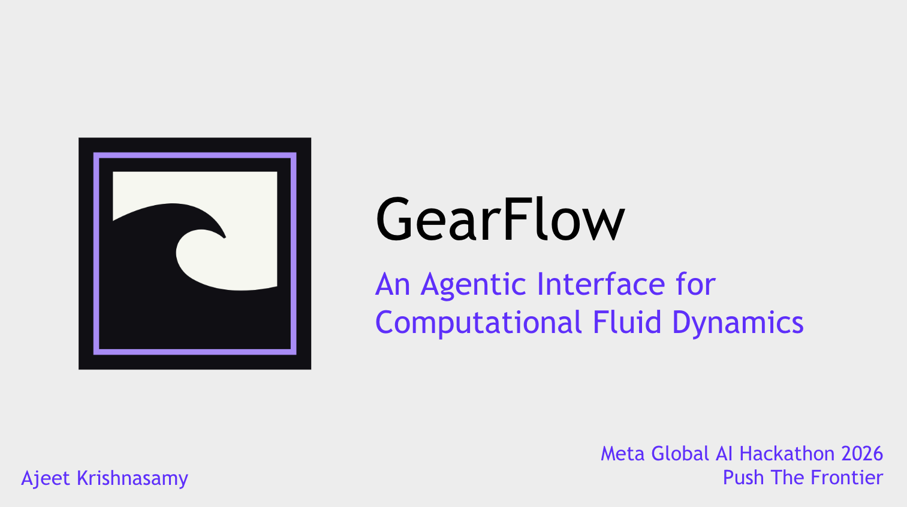
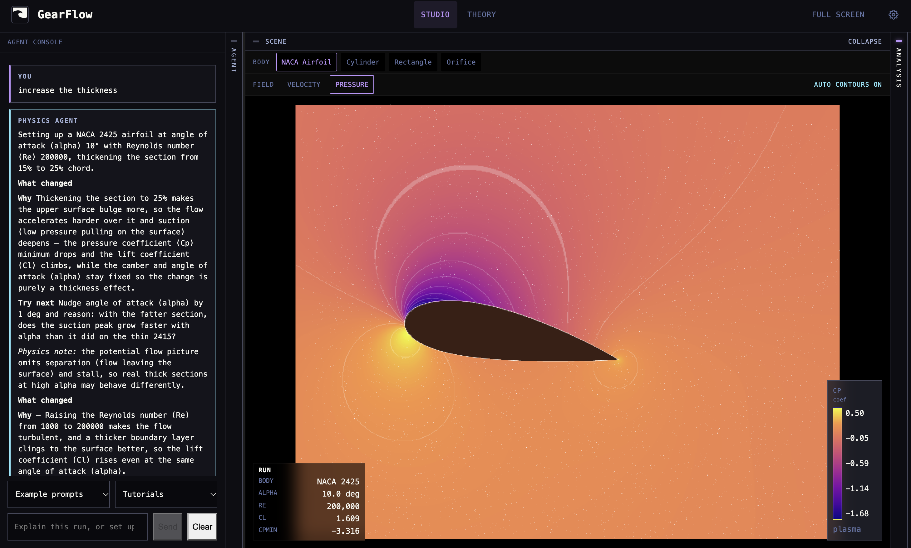
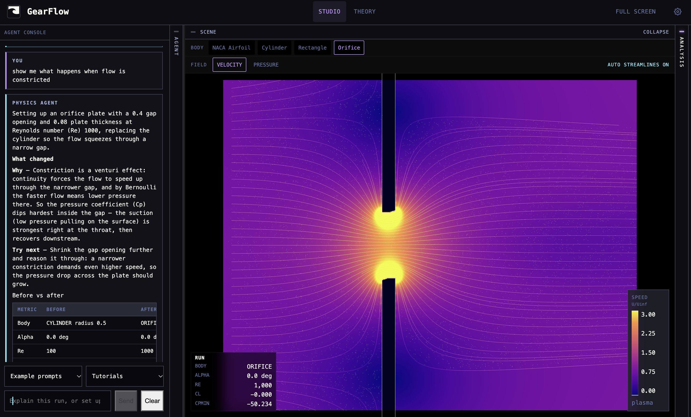

# GearFlow: An Agentic Interface for Computational Fluid Dynamics

What if you could set up an aerodynamics simulation in seconds, without being lost in a sea of menus. Traditional CFD tools are extremely powerful but setting up simulations can take hours.

With GearFlow, describe the simulation you want, and an agent sets it up, runs it, and explains the results.

Live App: https://gearflow-five.vercel.app
Demo Video: https://youtu.be/DIGMct427Ak

## Who it is for

Students can ask questions and receive instant visual feedback with physics explanations. Engineers can test simple ideas without wasting compute resources on expensive simulations.

## How it works, two frames

Type plain English in the left rail Agent Console and the physics agent replies with What changed, Why, and Try next, plus a Before versus After table. The center Scene canvas offers a body picker (NACA Airfoil, Cylinder, Rectangle, Orifice) and a field picker (Velocity, Pressure), with a RUN card reading out BODY, ALPHA, RE, CL, and CPMIN beside a labeled colorbar. Example prompts and Tutorials dropdowns plus the composer sit along the bottom, so each turn moves from words to field to explanation in one loop.

Frame 1, airfoil plus thickness question.

Screenshot alt: Agent Console on the left, Scene canvas with airfoil pressure field and RUN card on the right.

The user prompt reads increase the thickness. The canvas builds a NACA 2425 airfoil at alpha 10 deg and Re 200,000 in the Cp pressure field, with the RUN card reading BODY NACA 2425, ALPHA 10.0 deg, RE 200,000, CL 1.609, and CPMIN minus 3.316.

The tutor explains that the thicker section strengthens the suction peak while camber and alpha stay fixed, so the change is purely a thickness effect. It names Try next as nudging alpha by 1 deg to test whether the suction peak grows faster on the fatter section, and it carries the honest physics note that potential flow omits separation and stall, so real thick sections at high alpha may differ.

Frame 2, orifice plus constriction question.

Screenshot alt: Agent Console on the left, Scene canvas with orifice velocity field and streamlines on the right.

The user prompt reads show me what happens when flow is constricted. The canvas builds the orifice plate with 0.4 gap opening and 0.08 plate thickness at Re 1000 in the velocity field, with streamlines squeezing through the gap and the RUN card reading CPMIN minus 50.234.

The tutor explains the venturi effect, where continuity forces speedup through the gap and Bernoulli means lower pressure, so Cp dips hardest inside the gap and recovers downstream. The Before versus After table maps the prior cylinder case to the orifice, and Try next suggests shrinking the gap further to reason through even higher speed and a larger pressure drop.

Try it yourself in the [live demo](https://gearflow-five.vercel.app).

## Under the hood, one harness per turn

Every chat turn runs the same harness. Words go to a Meta text model through the Modal proxy with one completion, capped length at 400 tokens (`MODAL_MAX_TOKENS` in `src/agent/modalGate.ts`), temperature forced to 0 and `n` fixed to 1 (`forceModel` in `src/agent/modalGate.ts`), low reasoning effort (`MODAL_REASONING_EFFORT` in `src/agent/modalGate.ts`). The model answers in a fenced envelope of actions. A validator checks each action against the contract with a five action cap (`MAX_ENVELOPE_ACTIONS` in `src/agent/agentActions.ts`), and the app executor applies the valid ones (`src/ui/AgentConsole.tsx`). Then the tutor explains what changed, why, and what to try next, with a before versus after table (`src/ui/AgentConsole.tsx`). Session spend carries a 5 dollar soft cap (`SESSION_SPEND_CAP_USD` in `src/agent/sessionSpend.ts`). Failures land honest, with Retry and zero canvas writes (`src/ui/AgentConsole.tsx`).

## Current Limitations

At its current stage, the physics is idealized. Inviscid estimation leaves out friction and turbulence, and can never show real separation and stall.

## Next steps

Planned next steps are a built-in solver that the agent can drive end-to-end for real simulations, turning into a comprehensive CFD harness. Research is currently being done on implementing image plus audio inputs, so an owner can sketch a geometry or ask about turbulence by voice. The goal stays the same: pushing the boundaries of traditional CFD with agentic AI.

## Meta model usage status

| Status | Model or path | How it ships |
|--------|---------------|--------------|
| Live | Muse Spark via Modal (`gearflow-chat`) | Single live Meta text model in the judged loop, chat plus tutor, fail closed with Retry |
| Built but cut, code present, unmounted | Muse Image poster path | Explicit action only, not part of the judged loop, labeled cached when shown |
| Built but cut, code present, unmounted | SAM overlay | Cached and offline only, visual layer only, physics mask stays authoritative |
| Deferred | Glimmer local | No live path in this submission |
| Deferred | Wonder second voice | No live voice path in this submission |

## Media and third party assets

Docs media placeholders, all still TODO for the owner to land before submission: `docs/media/demo-2min.mp4`, `docs/media/shot-tunnel.png`, `docs/media/shot-agent.png`, `docs/media/shot-validation.png`, `docs/media/shot-export.png`, `docs/media/agent-setup-loop.gif`. No files exist under `docs/media` at the time of writing.

Slide images, all present, source and license TODO for the owner to fill before submission:

* `slides/images/cfd-car.webp` (exists, source TODO, license TODO)
* `slides/images/ansys-ui.jpg` (exists, source TODO, license TODO)
* `slides/images/cfd-car.jpg` (exists, source TODO, license TODO)

Never invent a source or license. The owner must confirm each asset is owned, licensed, or replaced before publishing.

## Docs map

* `docs/HACKATHON_RULES.md`: constraints, rubric source, submission requirements.
* `docs/DESIGN.md`: product story, demo script, wow moment.
* `docs/ARCHITECTURE.md`: solver, agent, and surrogate tech plan.
* `docs/DECISIONS.md`: decision log, what was chosen and why.
* `docs/RESEARCH.md`: background notes and measured findings.
* `docs/REVIEWS.md`: review history and quality gates.
* `docs/TESTS.md`: validation detail and test inventory.
* `docs/VIDEO_SCRIPT.md`: frozen spoken script and beat sheet, do not modify.

## Submission checklist

* [x] Live demo URL: https://gearflow-five.vercel.app/.
* [x] Demo video 2 to 3 min: https://youtu.be/DIGMct427Ak (unlisted).
* [ ] Public repo with this README (setup, keys, run steps).
* [ ] Short writeup (problem, users, Meta tooling, architecture, next steps).
* [ ] Licenses declared for third party assets and data.
* [ ] Submitted before Nov 4 9PM ET.
