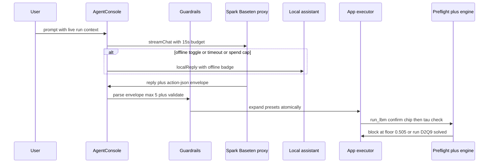
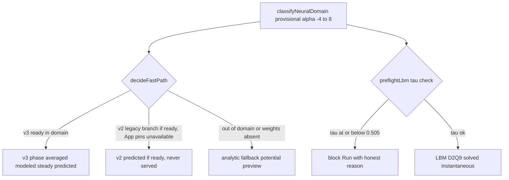

# GearFlow

The browser wind tunnel where chat sets up CFD and runs sims.

Live Demo URL: TODO | Video URL: TODO | Offline ready | Solo Indie Push the Frontier

## Demo first

<video src="docs/media/demo-2min.mp4" controls>Demo video placeholder, 2 to 3 minutes, file lands before submission.</video>

Watch: YouTube link TODO. One sentence hook: type a case in chat, watch the tunnel solve it, export the proof.

Script beats (2 to 3 minutes): hook with a live tunnel shot, agent setup from one prompt, a run with telemetry updating, an explain turn quoting live Cl and CpMin, export of PNG plus PDF. Full script lives in `docs/DESIGN.md`.

## What it does in 30 seconds

One core loop: describe a case in chat, the tunnel solves it, you read honest numbers beside the field.

* Chat builds real cases: bodies, alpha, Re, engine, and field switch from one prompt (`src/agent/casePresets.ts`).
* LBM runs are viscous and live in a worker with confirm chips and a preflight honesty gate (`src/flow/lbmRunConfig.ts`).
* Every number carries provenance: analytic, WASM parity, LBM solved snapshot, or surrogate predicted (`src/flow/solverRouter.ts`).

## Meet the agent

The canonical chat path is live Baseten Muse Spark (`src/agent/*`, `src/ui/AgentConsole.tsx`, model `meta-models/muse-spark-open-1026` via `/api/baseten/chat/completions`). Legacy `src/meta/*` (client, sparkChat, sparkSpec, cache, offlinePack) is fallback only.

What it does: creates cases from plain language, runs sims through guarded actions, and explains the live run with real Cl, CpMin, and regime context. Setup presets auto apply through the App executor, run and cancel render as confirm chips only, rejections arrive as honest reason text.

Try these verbatim prompts:

```text
Set up NACA 2412 alpha 6 Re 1200
```

```text
Explain this run with stall context
```

Action envelope: the model replies with fenced `action-json`, at most 5 validated actions per envelope (`src/agent/agentActions.ts`). `set_engine` accepts analytic or lbm only.

Phase 20 presets (`src/agent/casePresets.ts`, expansion is atomic, all or nothing; presets only set case fields and never arm LBM, so analytic serves until LBM is armed through the run confirm chip):

| Preset | Case | Backend note |
|--------|------|--------------|
| `setup_shedding` | cylinder, alpha 0, Re 100 | LBM served, solved |
| `setup_high_re_wake` | cylinder, alpha 0, Re 700 (preset library only, not chat reachable) | LBM served, modeled coarse LES above Re 500 |
| `setup_airfoil` | NACA body (default 2412), given alpha (default 6), Re 1200 | LBM served, modeled coarse LES above Re 500 (provisional neural planned coverage, weights not landed) |
| `high_pressure` | retired | Honest rejection always: the orifice plate diverges at every tested gap and Re in LBM, so it has no LBM path and stays analytic preview only |

Note: `setup_high_re_wake` lives in the preset library (`expandCasePreset` plus the App executor) but is absent from `SETUP_KINDS`, the envelope validator (`src/agent/agentActions.ts`), and the AgentConsole prompt kinds, so chat through AgentConsole cannot trigger it.

Guardrails: per action bounds on alpha and Re (presets carry their own validated Re), confirm chips for `run_lbm` and `cancel_lbm` that never auto run, 15s stream budget with Stop (`BASETEN_TIMEOUT_MS` in `src/ui/AgentConsole.tsx`), offline `localAssistant` fallback with badge, and `preflightLbm` hard blocks Run when predicted tau is at or below the 0.505 floor (`src/flow/lbmRunConfig.ts`).

## See it


*Caption TODO, owner TODO.*


*Caption TODO, owner TODO.*


*Caption TODO, owner TODO.*


*Caption TODO, owner TODO.*


*Caption TODO, owner TODO.*

Media note: docs/media files land before submission, gated by the submission checklist below. The paths above are placeholders until then.

## Features at a glance

| Feature | Demo value |
|---------|------------|
| Agent chat | One prompt sets up a full case, explains the run quoting live Cl and regime |
| Live tunnel | Speed, pressure, vorticity with particles and colormap control |
| Rust WASM LBM plus analytic | Viscous worker solves beside instant Hess Smith preview |
| Validation, 9 rows | PASS, WARN, INFO tiers against XFOIL and literature, judged live |
| Surrogate v3 comparison | Predicted frames next to analytic, labeled never validated |
| Export plus Offline pack | PNG and PDF carry the same numbers, booth survives no network |

## Solvers honestly

* Analytic Hess Smith potential: instant preview, inviscid core, no turbulence model.
* Rust WASM parity: matches the TypeScript solver, automatic fallback on any fault.
* Rust D2Q9 LBM: viscous solves in a worker, instantaneous snapshots, time averaged values are modeled not measured.
* Surrogate v3: dev weights only, predicted not validated, steady only, `harmonicCapable` false, provisional envelope, never use the word solved for its frames.
* Surrogate v2: contract complete but bundle absent. App pins v2 unavailable and never fetches it (`src/App.tsx:861-869`), while the router legacy branch would label v2 predicted if it were ready (the router has no retired concept).

Limits box: the inviscid core has no turbulence model, Cd is not validated on the inviscid path, Re shades the wake look only, neural output is predicted never validated, LBM frames are instantaneous snapshots never time averaged, and Phase A native verification diverged (Re 200 at step 576, Re 100 at step 10304, `src/flow/lbmRunConfig.ts:44`).

## How it flows

```mermaid
flowchart LR
    GEN["GEN analytic sweeps"] --> PILOT["Rust dataset_pilot v2 schema 8 bins"]
    PILOT --> MERGE["merge_sweep fail closed"]
    MERGE --> PRE["TRAIN pretrain Modal A10G plus L4 60ep batch32 lr3e-4"]
    PRE --> FINE["FINETUNE 300ep batch8 lr3e-4 shared A10G plus L4 request"]
    FINE --> EXP["EXPORT ONNX opset18 InstanceNorm batch1 128x128"]
    EXP --> BROW["BROWSER v3 async only, v2 pinned unavailable never fetched"]
    BROW --> DEC["decode sigmoid recirc plus expm1 TKE"]
    DEC --> ROUTE["ROUTER decideFastPath"]
```







## Validation you can trust

9 rows in `src/ui/ValidationPanel.tsx`: 3 PASS (0012 Cl at 4, 6, 8 deg vs XFOIL 500k; 2412 Cl at 4, 6, 8 deg vs XFOIL 500k; 2412 alpha zero vs thin airfoil theory), 2 WARN (100k rows are display only, bubble kink never PASS), 4 INFO (XFOIL fit reference, cylinder Strouhal band, cylinder Cd band, cylinder Cl amplitude). Only a fail on a PASS tier row blocks the demo. McCroskey, Ladson, Gregory, and Selig datasets are vendored under `fixtures/validation` with parsing tests. Detail: `docs/TESTS.md`.

## Meta orchestration

* Live: Muse Spark reasoning over the live run via Baseten (case setup plus coach explanations), plus the EvalLog ledger and agentCache.
* Legacy fallback (`src/meta/*`, unmounted `MetaPanel`, not wired by App): SAM 3.1 stays cached and offline only (the AgentConsole SAM control only toggles an explanatory note and never routes through Baseten), the Muse Image poster renders only on explicit action, and HashCache TTLs serve stale on fault.

## Run it in 5 minutes

```sh
cp .env.example .env
npm install
npm run dev
```

```sh
npm test
npm run build
```

Optional paths from `package.json`:

```sh
npm run wasm:build
npm run wasm:test
```

Then open with `?wasm=1` or `?engine=wasm`. For the judged booth copy with no network:

```sh
VITE_DEMO_OFFLINE=true npm run build
npm run build
npm run pack:offline
npx serve
```

## Judging alignment

| Criterion | Weight | GearFlow answer |
|-----------|--------|-----------------|
| Impact | 30 | CFD is gated and slow, students get instant visual intuition with validated numbers |
| Tooling | 25 | Spark reasons, SAM segments cached, Image renders on request, all visible with cost |
| Demo | 25 | One presenter, one loop, under 3 minutes, cached fallback plus offline pack |
| Depth | 20 | Hess Smith plus Rust parity plus D2Q9 worker plus tiers plus provenance on every run |

Solo Indie Push the Frontier: one owner, one core loop, one wow moment, accelerators for physical intuition.

## Docs map

* `docs/HACKATHON_RULES.md`: constraints, rubric source, submission requirements.
* `docs/DESIGN.md`: product story, demo script, wow moment.
* `docs/ARCHITECTURE.md`: solver, agent, and surrogate tech plan.
* `docs/DECISIONS.md`: decision log, what was chosen and why.
* `docs/RESEARCH.md`: background notes and measured findings.
* `docs/REVIEWS.md`: review history and quality gates.
* `docs/TESTS.md`: validation detail and test inventory.

## Submission checklist

* [ ] Live demo URL (TODO, add before Nov 4).
* [ ] Demo video 2 to 3 min (TODO, `docs/media/demo-2min.mp4` plus YouTube link).
* [ ] Public repo with this README (setup, keys, run steps).
* [ ] Short writeup (problem, users, Meta tooling, architecture, next steps).
* [ ] Licenses declared for third party assets and data.
* [ ] Submitted before Nov 4 9PM ET.

## Team status license

Solo Indie entry. Name and contact: [TODO, add name, email, profile link]. Status: shipped behavior described above with file anchors, no phase counts. License: [TODO, add license and LICENSE file before publishing].
